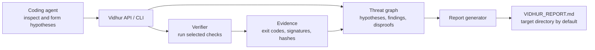

# Vidhur

Vidhur is an agent-assisted verification harness. A coding agent investigates a target, forms hypotheses, and uses Vidhur's Python API to run checks and store evidence in a threat graph. A finding is verified only when supported by a reproducible, machine-observable witness; a clean run is not proof that a project is secure.

Vidhur provides opt-in command execution, multi-package test discovery, Python and JavaScript/TypeScript static checks, basic DevOps checks, persistent finding state, and Markdown report generation. It does not independently inspect arbitrary source code or automatically patch findings; those tasks are performed by the coding agent using the protocol in [`VIDHUR.md`](VIDHUR.md).

Commands are disabled by default. `--allow-host-execution` runs target commands with the current user's permissions. Vidhur does not provide an OS sandbox; only enable this for trusted target code. Network isolation is not implemented and requests for it fail closed. Likely secret-bearing environment variables are filtered, but this is not a security boundary.

## Architecture



## Requirements

- Python 3.9 or later
- Additional tools required by a target's test and analysis commands, such as pytest, Node.js, Cargo, Go, or Docker

The engine uses Python's standard library. No third-party Python packages are required to invoke its CLI.

## Use

Keep this repository separate from the target project. Ask your coding agent to review [`VIDHUR.md`](VIDHUR.md), inspect the target, and use Vidhur's API to record and verify findings.

The test runner discovers Python, Node.js, Rust, Go, and explicit Makefile test suites in the root and bounded-depth package directories. When a package has no test suite, Vidhur separately discovers declared `build`, `check`, `typecheck`, or `validate` scripts; those results do not count as tests. Static checks currently cover Python (AST, Ruff, mypy) and JavaScript/TypeScript (ESLint, `tsc`). Missing tools, missing TypeScript configuration, and checks that cannot run are reported as `UNKNOWN`. Static coverage is limited to those languages and tools; Vidhur does not yet include general-purpose SAST, dependency, secret, API, or DAST scanners.

Run available automatic checks against a target:

```bash
python3 /path/to/vidhur/vidhur.py --target /path/to/project --allow-host-execution verify-layers
```

Layer 1 requires an explicit reproducer and expected safe-behavior pattern through the Python API; `verify-layers` reports it as `UNKNOWN` rather than inventing a pass.

Generate a report, or inspect the graph state:

```bash
python3 /path/to/vidhur/vidhur.py --target /path/to/project --allow-host-execution report --project "Project Name"
python3 /path/to/vidhur/vidhur.py --target /path/to/project status
```

By default, reports are written to `VIDHUR_REPORT.md` in the target directory. Use `--output` to choose another report path. Graph state is stored in a target-specific subdirectory under `~/.cache/vidhur/graph`; pass `--cache /path/to/cache-root` to select a different cache root.

Vidhur does not install target dependencies during ordinary checks. Venv provisioning is an explicit API operation and may install target-controlled packages.

For agent integration, import `Vidhur` from `vidhur.py`. It supports hypothesis recording, crash and Python assertion verification, adversarial re-testing, multi-layer checks, and report generation. A finding can be marked `PATCHED` only when the caller supplies verified Layer 1 and Layer 2 results. Static and DevOps results should also be included in the report when available.

Vidhur itself writes the report and cache outside the target source tree. Commands run by project tools may create their own files, such as test caches; Vidhur does not remove those files.

## Project Files

- [`VIDHUR.md`](VIDHUR.md): Agent workflow and verification protocol.
- [`vidhur.py`](vidhur.py): Public API and command-line interface.
- [`verifier.py`](verifier.py): Verification commands and witness collection.
- [`threat_graph.py`](threat_graph.py): Persistent findings, hypotheses, and disproof state.
- [`reporter.py`](reporter.py): Markdown report generation.
